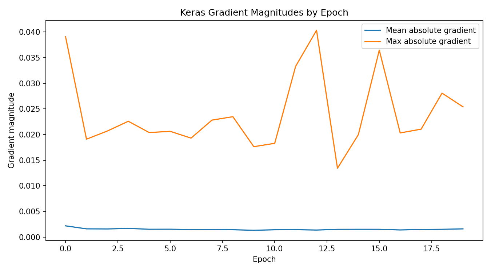
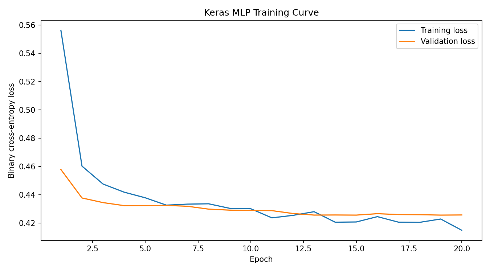
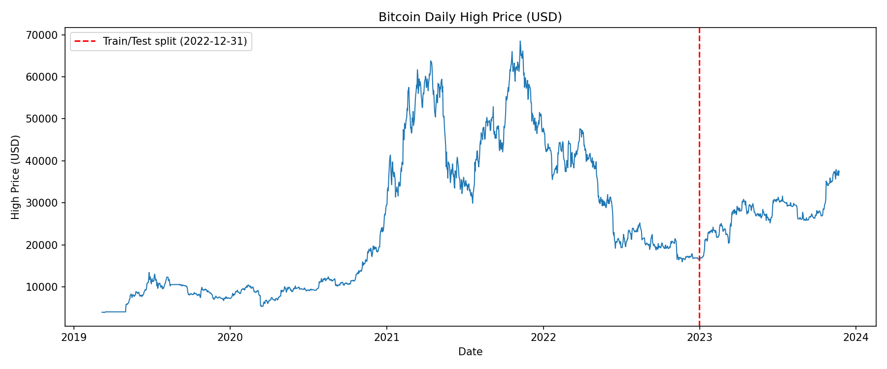
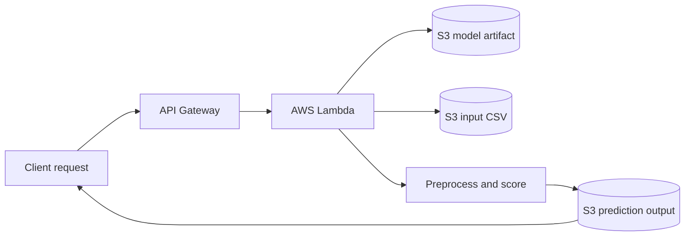

# Applied Predictive Analytics

### Customer Churn Classification, Bitcoin Forecasting, and Serverless Inference

An end-to-end machine-learning case study showing how model choice, evaluation, and deployment should adapt to two very different data structures: independent customer records and time-ordered financial observations.

## Executive summary

This project answers two applied prediction questions:

1. **Which telecom customers are most likely to churn?** Five classifiers were evaluated on a stratified holdout set. Gradient Boosting produced the strongest validation result with **0.8434 ROC-AUC** and **0.8062 accuracy**.
2. **How well can recent price history forecast Bitcoin's next-day high?** A 30-day LSTM baseline achieved **$897.45 RMSE** and **$658.26 MAE** on a strictly chronological 2023 test set.

The project also demonstrates a practical deployment tradeoff. The most accurate churn model was retained for analysis, while an SGD classifier was exported as a lightweight 7.4 KB JSON artifact for AWS Lambda. This avoided shipping a full scikit-learn runtime and supported batch inference for 7,043 rows in approximately 3.7 seconds during prototype testing.

## What this project demonstrates

- Reproducible preprocessing for mixed numeric and categorical data
- Fair comparison of classical ML and neural-network classifiers
- ROC-AUC-based model selection for an imbalanced binary outcome
- Gradient and loss monitoring for neural-network diagnostics
- Leakage-aware time-series preparation and chronological evaluation
- Model packaging for serverless, batch-oriented inference
- Clear separation between analytical performance and deployment constraints

## Results at a glance

| Workstream | Best result | Key decision |
|---|---|---|
| Customer churn | Gradient Boosting: **0.8434 ROC-AUC**, **0.8062 accuracy** | Use the strongest ensemble for analysis |
| Bitcoin forecasting | LSTM: **$897.45 RMSE**, **$658.26 MAE** | Treat as a one-day baseline, not a trading system |
| AWS inference | **7,043 rows in ~3.7 s**, **102 MB** | Deploy the smaller SGD artifact for portability |

## 1. Customer churn classification

### Problem

The objective is to estimate the probability that a telecom customer will leave. Each row represents one customer, so observation order is irrelevant and the predictors combine account tenure, charges, contract terms, and service selections.

### Data preparation

- Converted `TotalCharges` to numeric and imputed missing values with the median
- Mapped the `Churn` target from Yes/No to 1/0
- Removed `customerID` because it has no predictive meaning
- Standardized numeric features: `SeniorCitizen`, `tenure`, `MonthlyCharges`, and `TotalCharges`
- Imputed categorical values with the most frequent category and applied one-hot encoding
- Used an 80/20 stratified split to preserve the churn/non-churn balance

### Model comparison

| Model | Validation ROC-AUC | Accuracy | Role |
|---|---:|---:|---|
| Gradient Boosting | **0.8434** | **0.8062** | Best reporting model |
| Logistic Regression | 0.8413 | 0.7381 | Interpretable linear baseline |
| SGD Classifier | 0.8391 | 0.7530 | Lightweight deployment model |
| Keras MLP | 0.8366 | 0.7935 | Neural-network comparison |
| Random Forest | 0.8347 | 0.7842 | Bagged tree ensemble |


Gradient Boosting likely performed best because tree ensembles capture nonlinear interactions among contract type, tenure, monthly charges, and service combinations. Logistic Regression remained competitive and would be a reasonable alternative when explanation simplicity matters more than a small performance gain.

### Neural-network diagnostics

The Keras MLP uses dense ReLU layers, dropout, and a sigmoid output with Adam optimization and binary cross-entropy loss. Gradient tracking showed small but nonzero mean gradients and maximum magnitudes below roughly 0.04, providing no evidence of exploding or vanishing gradients. Training loss continued to improve after validation loss flattened, suggesting mild late-stage overfitting and limited value from additional epochs.





## 2. Bitcoin price forecasting

### Problem

The forecasting task predicts the next day's Bitcoin high from the previous 30 daily highs. Unlike the churn data, order is the signal: random splitting or shuffling would leak future information into training.

### Leakage-aware pipeline

1. Retained `Date` and `High`, sorted chronologically, and reindexed to daily frequency.
2. Forward-filled gaps, producing 1,721 continuous daily observations from March 2019 through November 2023.
3. Trained on 1,395 observations through December 31, 2022 and reserved 326 observations from 2023 for testing.
4. Fit `MinMaxScaler` on the training period only, then transformed the test period with the same scaler.
5. Created 30-day sliding windows with shape `(samples, 30, 1)`.
6. Trained a 64-unit LSTM with 0.2 dropout, an Adam optimizer, MSE loss, 50 epochs, and batch size 32.



### Forecast performance

| Metric | Test result |
|---|---:|
| RMSE | **$897.45** |
| MAE | **$658.26** |


The forecast followed the broad 2023 trend, including the early-year rise, summer consolidation, and late-year breakout. Its main weakness was lag during abrupt moves. Because the model uses only past prices, it cannot respond directly to volume, sentiment, regulation, liquidity, or macroeconomic shocks. The result should therefore be interpreted as a univariate forecasting baseline—not as a trading strategy.

## 3. Serverless inference architecture

The deployment prototype uses a request-response workflow for batch churn prediction:



The Lambda function reconstructs training-time preprocessing from a JSON artifact containing numeric medians, scaling parameters, categorical vocabularies, one-hot feature order, and SGD coefficients. It then computes probabilities with the logistic sigmoid directly in NumPy.

This design was intentional:

- **Portable:** no pickled model or scikit-learn dependency at runtime
- **Consistent:** inference uses the same feature order and transformation parameters as training
- **Small:** the saved artifact is approximately 7.4 KB
- **Batch-oriented:** prototype tests handled both 11-row and 7,043-row inputs successfully

The included handler expects its S3 bucket and model key through environment variables. The original demonstration endpoint is not published, and a production version should add authentication, least-privilege IAM policies, monitoring, and input validation.

## Analytical choices and tradeoffs

| Dimension | Churn classification | Bitcoin forecasting |
|---|---|---|
| Data structure | Independent customer rows | Temporally dependent observations |
| Target | Binary churn probability | Continuous next-day high |
| Split strategy | Stratified random holdout | Strict chronological holdout |
| Primary metrics | ROC-AUC and accuracy | RMSE and MAE in USD |
| Best-fit model | Tree-based ensemble | Recurrent neural network |
| Main risk | Class imbalance and calibration | Leakage, regime shifts, and volatility |

The central lesson is that model complexity should follow the structure of the data. Gradient Boosting was strongest for mixed tabular features, while the LSTM was appropriate for ordered sequences. For deployment, operational simplicity justified using a slightly weaker but more portable classifier.

## Limitations and next steps

### Churn

- Tune Gradient Boosting and compare XGBoost or LightGBM
- Add cross-validation and probability calibration
- Report feature importance or SHAP explanations
- Evaluate drift with newer customer cohorts
- Compare performance across customer segments

### Bitcoin

- Add volume, OHLC features, technical indicators, sentiment, and macro variables
- Predict returns or direction instead of the raw price level
- Compare GRU, stacked LSTM, Transformer, and naive persistence baselines
- Use walk-forward validation and prediction intervals
- Evaluate multi-step horizons such as 7 or 30 days

### Deployment

- Add API authentication and least-privilege IAM permissions
- Validate schemas and reject malformed input before inference
- Add logging, monitoring, versioned artifacts, and automated tests
- Trigger inference from S3 uploads and support larger batches

## Repository structure

```text
.
├── data/                 # Dataset sourcing and setup instructions
├── deployment/           # AWS Lambda inference handler
├── results/
│   ├── bitcoin/          # Forecast plots
│   └── churn/            # Metrics, diagnostics, and model artifact
├── src/
│   ├── forecast_bitcoin.py
│   └── train_churn_models.py
└── requirements.txt
```

## Run locally

Python 3.12 is recommended.

```bash
python -m venv .venv
source .venv/bin/activate
python -m pip install --upgrade pip
pip install -r requirements.txt
```

Download the datasets as described in [`data/README.md`](data/README.md), then run:

```bash
python src/train_churn_models.py
python src/forecast_bitcoin.py
```

Generated artifacts are saved under `results/`.

### Optional AWS artifact export

Local training never uploads to AWS by default. To export the churn artifact to an existing S3 bucket:

```bash
ENABLE_AWS_EXPORT=true \
MODEL_BUCKET=your-bucket \
MODEL_KEY=models/telco_churn_light_artifact.json \
AWS_REGION=us-east-1 \
python src/train_churn_models.py
```

## Project context

This work originated as a three-person academic team project for DSCI 352. This portfolio edition reorganizes the implementation, documents reproducible workflows, and presents the shared project transparently rather than claiming every component as individual work.

## Technology

Python, pandas, NumPy, scikit-learn, TensorFlow/Keras, Matplotlib, AWS Lambda, Amazon S3, and API Gateway.

## Usage

This repository is provided for portfolio review and educational reference. No open-source license is granted for reuse or redistribution.
