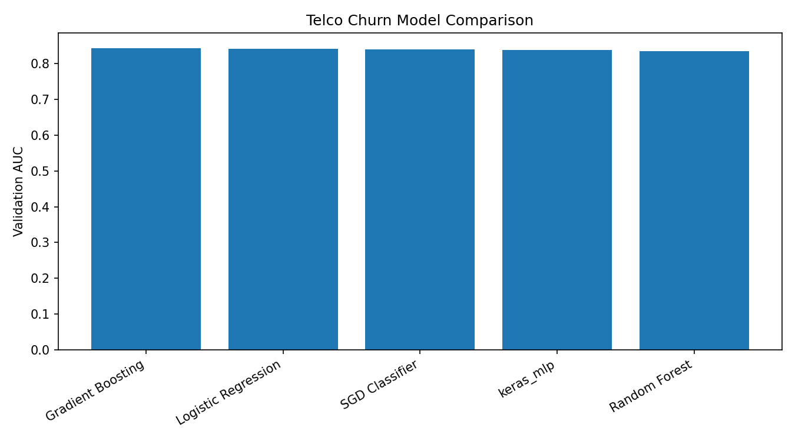
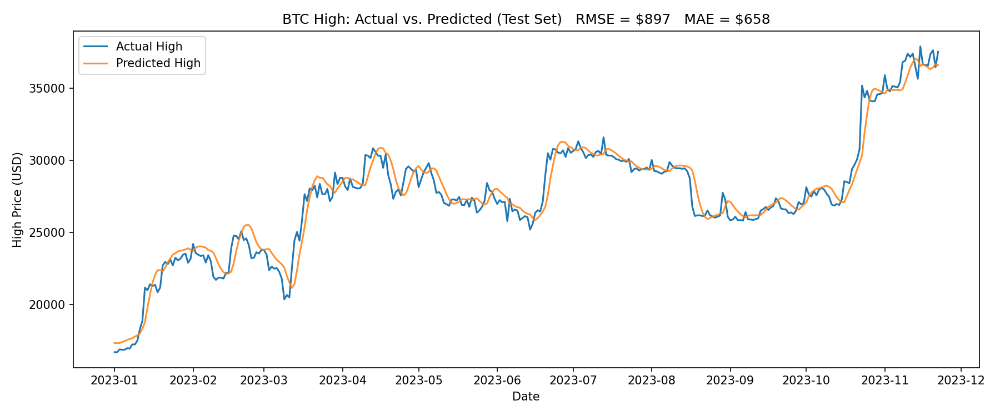

# Applied Predictive Analytics

### Customer Churn Classification & Bitcoin Price Forecasting

An end-to-end machine-learning portfolio project demonstrating tabular classification, neural-network diagnostics, time-series forecasting, and serverless model deployment.

## Highlights

- Benchmarked five churn classifiers using a consistent preprocessing pipeline.
- Achieved **0.843 validation ROC-AUC** with gradient boosting, the strongest churn model in the comparison.
- Tracked Keras gradient magnitude and training loss to monitor model health.
- Built a 30-day LSTM forecasting pipeline with a chronological train/test split for Bitcoin daily high prices.
- Packaged an AWS Lambda inference workflow using a lightweight JSON model artifact, S3, and API Gateway.

## Results

### Customer churn

| Model | Validation ROC-AUC | Accuracy |
|---|---:|---:|
| Gradient Boosting | **0.8434** | **0.8062** |
| Logistic Regression | 0.8413 | 0.7381 |
| SGD Classifier | 0.8391 | 0.7530 |
| Keras MLP | 0.8366 | 0.7935 |
| Random Forest | 0.8347 | 0.7842 |



### Bitcoin forecasting

The LSTM uses the previous 30 daily high prices to predict the following day. Training is limited to 2019–2022, and evaluation uses later observations to avoid look-ahead leakage.



## Repository structure

```text
.
├── data/                 # Dataset sourcing and setup instructions
├── deployment/           # AWS Lambda inference handler
├── results/
│   ├── bitcoin/          # Forecast plots
│   └── churn/            # Metrics, diagnostics, and deployment artifact
├── src/
│   ├── forecast_bitcoin.py
│   └── train_churn_models.py
└── requirements.txt
```

## Run locally

Python 3.12 is recommended.

```bash
python -m venv .venv
source .venv/bin/activate
python -m pip install --upgrade pip
pip install -r requirements.txt
```

Train and compare the churn models:

```bash
python src/train_churn_models.py
```

Train and evaluate the Bitcoin LSTM:

```bash
python src/forecast_bitcoin.py
```

Both scripts resolve paths from the repository root and save generated artifacts under `results/`.

## Optional AWS deployment

Local churn training never uploads to AWS by default. To export the lightweight model artifact to an existing S3 bucket, configure AWS credentials and explicitly enable the upload:

```bash
ENABLE_AWS_EXPORT=true \
MODEL_BUCKET=your-bucket \
MODEL_KEY=models/telco_churn_light_artifact.json \
AWS_REGION=us-east-1 \
python src/train_churn_models.py
```

The Lambda handler in `deployment/lambda_function.py` reads a customer CSV from S3, applies the saved preprocessing parameters and SGD coefficients, and writes JSON predictions back to S3.

## Methods

The churn workflow imputes numeric and categorical features, standardizes numeric columns, one-hot encodes categorical columns, and evaluates all candidates on the same stratified holdout set. The forecasting workflow reindexes the daily price series, forward-fills gaps, scales using training data only, creates sliding windows, and evaluates predictions in the original USD scale.

## Data

The raw datasets are intentionally not redistributed in this public portfolio. See [`data/README.md`](data/README.md) for sources, expected filenames, and schema requirements.

## Project context

This work originated as a three-person academic team project for DSCI 352. This portfolio edition reorganizes the implementation, documents reproducible workflows, and presents the shared project transparently rather than claiming every component as individual work.

## Tools

Python, pandas, NumPy, scikit-learn, TensorFlow/Keras, Matplotlib, AWS Lambda, Amazon S3, and API Gateway.

## Usage

This repository is provided for portfolio review and educational reference. No open-source license is granted for reuse or redistribution.

